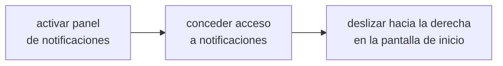

# NOTIFICACIONES Y WIDGETS

<a href="../README.md">indice</a> · <a href="../../en/users/09-notifications-and-widgets.md">english</a> · anterior: <a href="./08-personalizacion.md">personalizacion</a> · siguiente: <a href="./10-referencia-de-ajustes.md">referencia de ajustes</a>

---

## EL PANEL LATERAL DE NOTIFICACIONES

focusphone puede mostrar tus notificaciones en un cajon propio, que se abre **deslizando
hacia la derecha** en la pantalla de inicio. es una alternativa mas tranquila a la persiana
del sistema: solo texto, con el estilo del tema que estes usando.

### ACTIVARLO

**ajustes → notificaciones**

1. activa **panel de notificaciones**
2. concede el permiso de **acceso a notificaciones**: focusphone abre directamente la
   pantalla de android donde se concede
3. desliza hacia la derecha en la pantalla de inicio

### COMO SE USA

| accion | resultado |
|---|---|
| tocar una notificacion | abre la aplicacion correspondiente |
| deslizar una notificacion hacia la derecha | la descarta |
| boton de limpiar | descarta todas a la vez |

### PRIVACIDAD

<table>
<tr>
<td>

el contenido de las notificaciones (titulo y texto) **vive unicamente en la memoria ram**.
no se escribe nunca en disco, no se guarda en ninguna base de datos y no sale del
dispositivo. cuando el proceso de focusphone termina, la lista se vacia y se vuelve a
poblar la proxima vez que el servicio se conecta.

</td>
</tr>
</table>

---

## EL GESTO HACIA ABAJO

**ajustes → notificaciones → gesto hacia abajo**

con este ajuste activo, deslizar hacia abajo en la pantalla de inicio despliega la
**persiana de notificaciones de android**, la de siempre, sin necesidad de llegar al borde
superior de la pantalla.

<strong>funciona mejor con el servicio de accesibilidad</strong>

 

focusphone usa la accion oficial de accesibilidad para desplegar la persiana. si el
servicio de accesibilidad de focusphone esta activo, el gesto funciona siempre y de forma
fiable.

sin el servicio, focusphone intenta una via alternativa mas antigua que android bloquea a
partir de la version 12, asi que en moviles modernos el gesto puede no responder. si te
pasa, activa el servicio de accesibilidad en **ajustes → sistema → bloqueo del sistema**.

---

## INSIGNIAS DE NOTIFICACION

la seccion de notificaciones tambien controla si las aplicaciones de la pantalla de inicio
muestran un indicador cuando tienen notificaciones pendientes. es un indicador discreto y
de texto, coherente con el resto de la interfaz: no hay circulos rojos.

---

## EL WIDGET DE LA PANTALLA DE INICIO

focusphone admite **un unico widget** en la pantalla de inicio. es una decision
deliberada: una rejilla de widgets convertiria la pantalla en el mismo escaparate del que
se intenta salir.

### AÑADIR UN WIDGET

**ajustes → pantalla de inicio → widget**

1. pulsa la fila del widget
2. elige un widget de la lista de los que ofrecen tus aplicaciones
3. si el widget necesita configuracion propia, se abre su pantalla de configuracion
4. el widget aparece en la pantalla de inicio, en la posicion que tenga en la distribucion

### QUITARLO O CAMBIARLO

| accion | como |
|---|---|
| cambiar de widget | vuelve a la fila del widget y elige otro |
| quitar el widget | pulsa *quitar widget* y confirma |
| ocultarlo sin quitarlo | desactiva el bloque del widget en *distribucion* |

<strong>widgets que encajan bien</strong>

 

los widgets que menos rompen la estetica son los de texto o los de una sola dato:

- tiempo, en su version compacta
- proximo evento del calendario
- nota rapida
- control de musica minimalista
- contador de pasos

los que peor encajan son los widgets grandes con imagenes, carruseles o fuentes de noticias:
funcionan, pero desplazan hacia abajo la lista de favoritos y devuelven el ruido visual a la
pantalla.

---

## RESUMEN DE PERMISOS DE ESTA SECCION

| funcion | permiso necesario | obligatorio |
|---|---|---|
| panel lateral de notificaciones | acceso a notificaciones | solo para esta funcion |
| gesto hacia abajo | servicio de accesibilidad (recomendado) | no, pero sin el puede no funcionar en android 12+ |
| insignias de notificacion | acceso a notificaciones | solo para esta funcion |
| widget | ninguno | — |

---

<a href="./08-personalizacion.md">← personalizacion</a> · <a href="../README.md">indice</a> · <a href="./10-referencia-de-ajustes.md">referencia de ajustes →</a>

