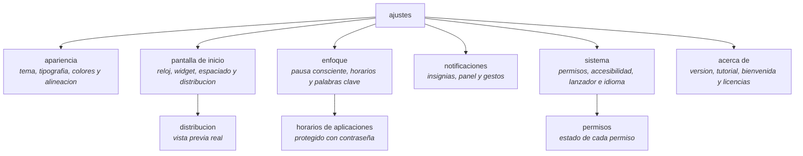

# REFERENCIA DE AJUSTES

<a href="../README.md">indice</a> · <a href="../../en/users/10-settings-reference.md">english</a> · anterior: <a href="./09-notificaciones-y-widgets.md">notificaciones y widgets</a> · siguiente: <a href="./11-privacidad-y-permisos.md">privacidad y permisos</a>

---

## COMO ESTAN ORGANIZADOS

los ajustes se abren desde el menu lateral, en **ajustes de focus**. la pantalla principal
no contiene ningun control: es un menu de seis categorias, y cada una abre su propia
pantalla.

---

## APARIENCIA

<strong>seccion: apariencia</strong>

 

| ajuste | tipo | valores | efecto |
|---|---|---|---|
| tema | selector | off-white · slate · warm beige · navy · auto · personalizado | cambia toda la paleta de colores de la aplicacion |

con el tema **personalizado** se despliega un panel con dos campos de color hexadecimal
(`#RRGGBB`): fondo y texto. un valor no valido se rechaza con un aviso y se mantienen los
colores seguros por defecto.

<strong>seccion: tipografia</strong>

 

| ajuste | tipo | valores |
|---|---|---|
| tipografia | selector con muestra en vivo | sistema · poppins · comfortaa · jetbrains mono |

<strong>seccion: texto y distribucion</strong>

 

| ajuste | tipo | rango | por defecto |
|---|---|---|---|
| tamaño de texto | deslizador | 8 a 24 puntos, paso de 1 | 14 |
| alineacion | selector de tres iconos | izquierda · centro · derecha | centro |
| ocultar la barra de estado | interruptor | si / no | no |

<strong>seccion: fondo de pantalla</strong>

 

| ajuste | tipo | detalle |
|---|---|---|
| activar fondo de pantalla | interruptor | interruptor principal; con el apagado se oculta todo lo demas de la seccion |
| mismo fondo en todas las pantallas | interruptor | una sola imagen para inicio, notificaciones y ajustes |
| imagen | fila con vista previa | se toca para abrir el selector de imagenes de android |
| inicio / notificaciones / ajustes | tres filas | solo aparecen con el modo compartido desactivado; cada pantalla lleva su propia imagen |
| desenfoque | interruptor | difumina la imagen |
| intensidad del desenfoque | deslizador | solo visible con el desenfoque activo |
| legibilidad del texto | deslizador | 0 a 100, por defecto 60 |

las opciones de esta seccion se aplican **al instante en la propia pantalla de ajustes**,
sin recargarla.

---

## PANTALLA DE INICIO

<strong>seccion: reloj</strong>

 

| ajuste | tipo | valores | por defecto |
|---|---|---|---|
| tipo de reloj | selector con miniaturas | digital · apilado · en palabras · analogico · oculto | digital |
| tamaño del reloj | deslizador | 0 a 100 | — |

<strong>seccion: lanzador</strong>

 

| ajuste | tipo | rango | efecto |
|---|---|---|---|
| espaciado entre apps | deslizador | 0 a 40 dp | separacion vertical entre las filas de favoritos |
| widget | fila con valor | ninguno, o el nombre del widget activo | añade, cambia o quita el unico widget de la pantalla de inicio |
| distribucion | abre otra pantalla | — | reordena y oculta reloj, widget y lista de apps, con vista previa real |

---

## ENFOQUE

<strong>seccion: pausa consciente</strong>

 

| ajuste | tipo | rango | por defecto |
|---|---|---|---|
| activar pausa consciente | interruptor | si / no | no |
| duracion | deslizador | 3 a 10 segundos | — |

con la pausa desactivada, la fila de duracion se atenua entera, no solo el deslizador.

<strong>seccion: aplicaciones programadas</strong>

 

| ajuste | tipo | detalle |
|---|---|---|
| horarios de aplicaciones | abre otra pantalla | pantalla protegida con contraseña; ver [horarios de aplicaciones](./06-horarios-de-aplicaciones.md) |

<strong>seccion: perfil de trabajo</strong>

 

| ajuste | tipo | detalle |
|---|---|---|
| palabras clave del modo trabajo | campo de texto multilinea | una palabra por linea; se guardan en minusculas, ignorando lineas vacias |

pulsa **guardar** para aplicar los cambios. una lista vacia es valida: en ese caso solo se
bloquean las aplicaciones que hayas marcado a mano.

---

## NOTIFICACIONES

<strong>seccion: notificaciones</strong>

 

| ajuste | tipo | detalle |
|---|---|---|
| acceso a notificaciones | fila con estado | muestra *activo* o *inactivo*; al pulsarla abre la pantalla de android donde se concede |
| panel de notificaciones | interruptor | activa el cajon lateral de notificaciones de focusphone |
| gesto hacia abajo | interruptor | permite desplegar la persiana del sistema deslizando hacia abajo en la pantalla de inicio |

---

## SISTEMA

<strong>seccion: sistema</strong>

 

| ajuste | tipo | detalle |
|---|---|---|
| permisos | abre otra pantalla | lista el estado de cada permiso: concedido / denegado, activo / inactivo |
| bloqueo del sistema | fila con estado | estado del servicio de accesibilidad; al pulsarla abre la pantalla de accesibilidad de android |
| establecer como predeterminado | fila con estado | indica si focusphone es el lanzador por defecto y abre la pantalla para cambiarlo |

<strong>seccion: idioma</strong>

 

| ajuste | tipo | valores |
|---|---|---|
| idioma | fila con valor | sistema · ingles · ingles britanico · español · frances · aleman |

el cambio afecta solo a focusphone, no al resto del movil.

<strong>la pantalla de permisos</strong>

 

| permiso | estado que muestra | necesario para |
|---|---|---|
| ver aplicaciones instaladas | concedido / denegado | listar aplicaciones en el cajon y en el selector |
| servicio de accesibilidad | activo / inactivo | bloqueo real y limites diarios de uso |
| lanzador por defecto | activo / inactivo | que el boton de inicio abra focusphone, y los accesos directos de aplicacion |

---

## ACERCA DE

<strong>seccion: acerca de</strong>

 

| fila | que hace |
|---|---|
| version | muestra la version instalada; al pulsarla abre la politica de privacidad |
| tutorial | abre el tutorial interactivo, que resalta los elementos reales de la pantalla de inicio |
| reiniciar el tutorial | vuelve a empezar el tutorial desde el primer paso, previa confirmacion |
| reiniciar la bienvenida | vuelve a lanzar la bienvenida de 5 pasos, previa confirmacion |
| codigo abierto | muestra las licencias de las bibliotecas de terceros utilizadas |

---

## TABLA RAPIDA: DONDE ESTA CADA COSA

| quiero… | ruta |
|---|---|
| cambiar el color de la aplicacion | apariencia → tema |
| poner mis propios colores | apariencia → tema → personalizado |
| cambiar la letra | apariencia → tipografia |
| hacer el texto mas grande | apariencia → tamaño de texto |
| mover la lista a un lado | apariencia → alineacion |
| quitar la barra de estado | apariencia → ocultar la barra de estado |
| poner una foto de fondo | apariencia → fondo de pantalla |
| cambiar el estilo del reloj | pantalla de inicio → tipo de reloj |
| quitar el reloj | pantalla de inicio → tipo de reloj → oculto |
| añadir un widget | pantalla de inicio → widget |
| reordenar reloj, widget y apps | pantalla de inicio → distribucion |
| separar mas las aplicaciones | pantalla de inicio → espaciado entre apps |
| respirar antes de abrir una app | enfoque → pausa consciente |
| limitar una app por horas | enfoque → horarios de aplicaciones |
| ajustar que bloquea el modo trabajo | enfoque → palabras clave del modo trabajo |
| ver las notificaciones en focusphone | notificaciones → panel de notificaciones |
| desplegar la persiana con un gesto | notificaciones → gesto hacia abajo |
| activar el bloqueo real | sistema → bloqueo del sistema |
| poner focusphone como pantalla de inicio | sistema → establecer como predeterminado |
| cambiar el idioma de la app | sistema → idioma |
| repetir el tutorial | acerca de → tutorial |
| ver la version instalada | acerca de → version |

---

<a href="./09-notificaciones-y-widgets.md">← notificaciones y widgets</a> · <a href="../README.md">indice</a> · <a href="./11-privacidad-y-permisos.md">privacidad y permisos →</a>

