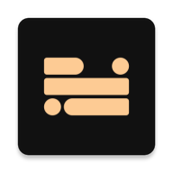
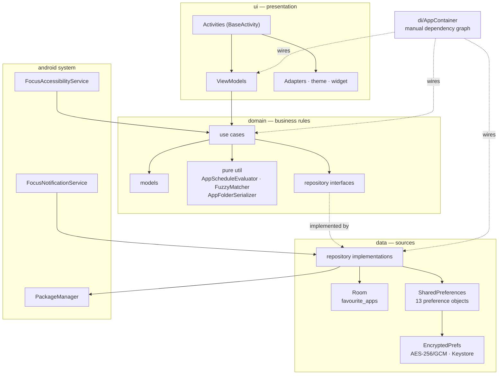

<div align="center">



# FOCUSPHONE

<strong>a minimalist android launcher that replaces your home screen with a list of text:<br>
a clock, a calendar and only the apps you actually use.</strong>

<br>


<br>


<a href="./license"></a>

<br><br>

<a href="./documentation/en/README.md"><b>documentation</b></a> ·
<a href="./documentation/en/developers/01-architecture.md"><b>architecture</b></a> ·
<a href="./changelog.md"><b>changelog</b></a> ·
<a href="./security.md"><b>security policy</b></a> ·
<a href="https://github.com/rezzt-dev/focusphone-app/issues"><b>report a bug</b></a> ·
<a href="https://github.com/rezzt-dev/focusphone-app/issues"><b>request a feature</b></a>

</div>

---

## TABLE OF CONTENTS

- [overview](#overview)
- [the home screen](#the-home-screen)
- [features](#features)
- [architecture](#architecture)
- [technology stack](#technology-stack)
- [repository layout](#repository-layout)
- [project structure](#project-structure)
- [getting started](#getting-started)
- [build and verification](#build-and-verification)
- [testing and quality](#testing-and-quality)
- [security and privacy](#security-and-privacy)
- [internationalization](#internationalization)
- [documentation](#documentation)
- [project status](#project-status)
- [contributing](#contributing)
- [license](#license)
- [author](#author)

---

## OVERVIEW

most android launchers are designed so that you open apps: colourful icons, red badges and
grids full of suggestions act as constant reminders. every time you unlock the phone to check
the time, you see twenty reasons to stay.

**focusphone starts from the opposite idea: the home screen should be a place you pass
through, not a place you stay in.** the interface is text only, favourites are capped at ten,
and blocking — once configured behind a password — is designed to actually hold.

<table>
<tr>
<th align="left" width="50%">a normal launcher</th>
<th align="left" width="50%">focusphone</th>
</tr>
<tr>
<td valign="top">

- dozens of icons in view
- colourful badges demanding attention
- several screens in a carousel
- icon folders with animations
- automatic app suggestions
- opening an app is a reflex tap

</td>
<td valign="top">

- a text list capped at ten apps
- no icons on the home screen
- a single screen, no carousel
- text folders, only in the app drawer
- nothing is suggested: you decide what appears
- optionally, a breath before opening

</td>
</tr>
</table>

### DESIGN PRINCIPLES

| principle | how it is enforced in the code |
|---|---|
| **text over icons** | the home screen renders labels only; icons exist solely in the app drawer |
| **offline by construction** | the app declares no `INTERNET` permission — there is no network layer to audit |
| **blocks that hold** | detox and schedule passwords are pbkdf2-hashed and rate limited; a wrong password never clears a rule |
| **no flash of unstyled content** | theme, font and scale are read synchronously in `BaseActivity.attachBaseContext()`, before `setContentView` |
| **one source of truth for colour** | every runtime colour goes through `FocusPalette` / `FocusColors`, never `resolveAttribute` |
| **pure logic is testable logic** | schedule evaluation, folder serialization, contrast maths and fuzzy search live in pure classes under `domain/util` and `ui/theme` |

---

## THE HOME SCREEN

```
┌──────────────────────────────────┐
│                                  │
│              09:41               │  ← clock (5 styles, tap it for alarms)
│          monday, 12 may          │
│                                  │
│  ┌────────────────────────────┐  │
│  │      optional widget       │  │  ← widget (exactly one, optional)
│  └────────────────────────────┘  │
│                                  │
│              phone               │
│             messages             │  ← favourites (up to 10, text only)
│              camera              │
│               notes              │
│                                  │
└──────────────────────────────────┘
   ↑ swipe right         ↑ swipe left
   notifications         menu
```

| gesture | result |
|---|---|
| swipe left | opens the app drawer with search and folders |
| swipe right | opens the notification / quick-access drawer |
| swipe down | expands the system notification panel (`GLOBAL_ACTION_NOTIFICATIONS`) |
| tap the clock | opens the system alarm app |
| long-press a favourite | drag to reorder, or open the per-app options menu |

> the three home components (clock, widget, favourites) can be hidden and reordered from
> **settings → home screen → layout**, with a live preview.

<sub>screenshots land with the first public release; until then the
[user documentation](./documentation/en/users/03-home-screen-and-gestures.md) walks through every
screen.</sub>

---

## FEATURES

<details open>
<summary><strong>home screen and navigation</strong></summary>

<br>

- **text-only favourites** — up to 10 apps, rendered as labels, reorderable by drag and drop.
- **five clock styles** — `DIGITAL`, `STACKED`, `WORDS`, `ANALOG`, `HIDDEN`, honouring the
  system's 12/24-hour setting.
- **gesture drawers** — app drawer and notification drawer, one swipe away in each direction.
- **fuzzy app search** — subsequence matching with scoring (`FuzzyMatcher`), so `wapp` finds
  `whatsapp`.
- **app-drawer folders** — created by drag and drop or from the long-press menu; a package
  belongs to at most one folder, an invariant enforced in the preference layer rather than in
  the ui.
- **custom app labels** — rename any app; the label is stored encrypted and merged on read.
- **one optional widget** — a single app widget hosted on the home screen through
  `AppWidgetHostManager`.

</details>

<details>
<summary><strong>focus and blocking</strong></summary>

<br>

| mechanism | what it does |
|---|---|
| **normal profile** | nothing is blocked |
| **work profile** | blocks manually selected apps plus anything matching user-editable keywords |
| **detox profile** | blocks every app except focusphone, for a timed session; exiting early needs the password, and the session always ends on its own when the timer expires |
| **app schedules** | per-app allowed time window (weekday aware, windows may wrap past midnight) and/or a daily allowance that resets at local midnight — evaluated **on top of** the active profile |
| **conscious pause** | a breathing countdown before a chosen app opens, so opening it becomes a decision instead of a reflex |

blocking decisions live in the pure `AppScheduleEvaluator`, so they are fully unit tested.
every in-app launch path calls `BaseActivity.enforceAppSchedule()`; the optional
`FocusAccessibilityService` covers launches that bypass focusphone entirely (notifications,
recents, voice assistants) and is the only component that can measure foreground time, so
daily allowances need it enabled while time windows work without it.

</details>

<details>
<summary><strong>appearance and customization</strong></summary>

<br>

- **four built-in themes** — `off_white`, `slate`, `warm_beige`, `navy`, plus a **custom** theme
  with user-chosen hex colours and an **auto** mode that follows system day/night.
- **wcag contrast guard** — `FocusColors.ensureContrast` corrects a custom colour pair the user
  picked that would be unreadable, instead of rendering it.
- **wallpapers** — picked images are downscaled, exif-rotated and copied into private storage, so
  they survive reboots; optional blur and an adaptive legibility scrim keep text readable over any
  photo.
- **typography** — system font plus bundled `poppins`, `comfortaa` and `jetbrains mono`;
  independent text-size and clock-size scales.
- **layout control** — left / center / right alignment, app spacing, status bar visibility, and
  reorderable home components.

</details>

<details>
<summary><strong>system integration</strong></summary>

<br>

- **real launcher** — declares the `HOME` / `DEFAULT` / `LAUNCHER` intent filter and can be set as
  the default home app.
- **edge-to-edge** — insets are applied manually per screen; content draws under the status and
  navigation bars.
- **notification listener** (optional) — feeds the in-app notification drawer and badges.
- **accessibility service** (optional) — system-wide launch interception and foreground-time
  accounting; never enabled by default, always prompted for.
- **package change monitor** — the app list reacts to installs, updates and uninstalls without a
  manual refresh.

</details>

---

## ARCHITECTURE

focusphone is a single-module android application following **clean architecture (lite)** with
**mvvm** in the presentation layer. there is no compose: the ui is built with view binding over
xml layouts, which keeps the apk small and startup cheap.



### LAYER RESPONSIBILITIES

<table>
<tr><th align="left">layer</th><th align="left">contains</th><th align="left">may depend on</th></tr>
<tr>
<td><code>domain</code></td>
<td>models, use cases, repository interfaces, pure algorithms</td>
<td>nothing android-specific, except where a model wraps a platform type</td>
</tr>
<tr>
<td><code>data</code></td>
<td>room database and dao, preference objects, repository implementations, encrypted storage</td>
<td><code>domain</code> + the android framework</td>
</tr>
<tr>
<td><code>ui</code></td>
<td>activities, viewmodels, adapters, theme engine, widget hosting</td>
<td><code>domain</code>, and <code>data</code> only through <code>AppContainer</code></td>
</tr>
<tr>
<td><code>di</code></td>
<td><code>AppContainer</code>: every singleton, repository and use case, wired by hand</td>
<td>all layers</td>
</tr>
</table>

### KEY DECISIONS

<details>
<summary><strong>manual dependency injection instead of hilt</strong></summary>

<br>

`AppContainer`, held by `FocusPhoneApp`, wires every singleton by hand and exposes
`ViewModelProvider.Factory` builders. hilt is deliberately avoided while agp 9.x
annotation-processing compatibility is unresolved. the container also accepts optional
repository overrides, which is how instrumented tests substitute fakes before an activity
launches.

</details>

<details>
<summary><strong>sharedpreferences for settings, room for data</strong></summary>

<br>

theme, font and scale must be read **synchronously** inside `BaseActivity.attachBaseContext()`
and before `setContentView`, or the user sees a flash of the previous theme. datastore's
asynchronous api cannot satisfy that, so settings stay on `SharedPreferences` (encrypted where
they hold user content), while the favourites list — the only relational data in the app — lives
in room, with a one-off migration from the legacy pipe-delimited string format.

</details>

<details>
<summary><strong>one palette object owns every runtime colour</strong></summary>

<br>

`Theme.resolveAttribute(attr, tv, true).data` yields a *resource id* rather than a colour
whenever the attribute resolves to a `ColorStateList`, and it knows nothing about the custom
theme. every colour therefore goes through `FocusPalette.of(context)`, with `FocusColors`
providing luminance and contrast maths and `SurfaceScrim` computing the adaptive scrim drawn
between a wallpaper and the content.

</details>

<details>
<summary><strong>schedules are evaluated independently of profiles</strong></summary>

<br>

an app can be restricted by a schedule even on a normal-profile device. keeping the two systems
orthogonal means the decision function stays pure: `AppScheduleEvaluator` takes a rule, a clock
and the accumulated usage, and returns a `ScheduleBlockReason` — no context, no preferences, no
android dependencies, and therefore full unit coverage of midnight wrapping, weekday filtering
and allowance exhaustion.

</details>

---

## TECHNOLOGY STACK

<table>
<tr><th align="left" width="26%">area</th><th align="left">choice</th></tr>
<tr><td>language</td><td>kotlin, 100% of the source; coroutines + <code>StateFlow</code> / <code>SharedFlow</code> for reactive state</td></tr>
<tr><td>ui toolkit</td><td>android views + view binding, material 3 components, no jetpack compose</td></tr>
<tr><td>architecture</td><td>clean architecture (lite) + mvvm, repository pattern, use cases</td></tr>
<tr><td>persistence</td><td>room <code>2.8.5</code> (favourites) · <code>SharedPreferences</code> (settings) · aes-256/gcm through android keystore (user content)</td></tr>
<tr><td>androidx</td><td>core-ktx <code>1.18.0</code>, appcompat <code>1.8.0</code>, activity-ktx <code>1.13.0</code>, fragment-ktx <code>1.9.0</code>, lifecycle <code>2.11.0</code>, constraintlayout <code>2.2.2</code>, recyclerview <code>1.4.0</code>, viewpager2 <code>1.1.0</code></td></tr>
<tr><td>material</td><td>com.google.android.material <code>1.14.0</code></td></tr>
<tr><td>build</td><td>gradle <code>9.7.1</code> (wrapper) · agp <code>9.3.0</code> · version catalog (<code>gradle/libs.versions.toml</code>) · kapt for room</td></tr>
<tr><td>toolchain</td><td>jdk <code>21</code> daemon toolchain via <code>gradle/gradle-daemon-jvm.properties</code>; java source/target compatibility <code>11</code></td></tr>
<tr><td>testing</td><td>junit4 · mockk <code>1.14.11</code> · robolectric <code>4.17</code> · turbine <code>1.2.1</code> · coroutines-test · espresso <code>3.7.0</code></td></tr>
<tr><td>release</td><td>r8 minification + resource shrinking, lint-vital gating the release build</td></tr>
</table>

---

## REPOSITORY LAYOUT

```txt
focusphone-app/
├── focusphone-project/          # the android project (gradle root)
│   ├── app/                     # the single application module
│   ├── gradle/                  # version catalog + daemon toolchain criteria
│   ├── build.gradle.kts
│   ├── settings.gradle.kts
│   └── gradlew · gradlew.bat    # versioned wrapper
├── documentation/               # full bilingual documentation
│   ├── es/{usuarios,desarrolladores}/
│   └── en/{users,developers}/
├── .github/                     # ci workflows, dependency policy, issue and pr templates
├── agents.md · claude.md        # operating guide for ai agents and maintainers
├── changelog.md                 # bilingual, keep-a-changelog style
├── code_of_conduct.md           # contributor covenant 2.1, single-author enforcement
├── contributing.md              # short contributor guide; the long one is in documentation/
├── license                      # non-commercial license
├── security.md                  # security policy and vulnerability reporting
└── readme.md
```

> the gradle root is `focusphone-project/`, not the repository root: open **that** directory in
> android studio, and run every `./gradlew` command from inside it.

---

## PROJECT STRUCTURE

```txt
focusphone-project/app/src/main/java/app/focusphone/
│
├── FocusPhoneApp.kt                  # application class; owns the AppContainer
├── di/
│   └── AppContainer.kt               # manual di graph: singletons, repositories, use cases
│
├── data/
│   ├── local/                        # AppDatabase · FavouriteAppDao
│   ├── model/                        # FavouriteApp (room entity)
│   ├── preferences/                  # 13 preference objects: theme, font, profiles,
│   │                                 # schedules, folders, wallpaper, widget, gestures,
│   │                                 # notifications, home layout, labels, pause, tutorial
│   └── repository/                   # app & favourite repositories, notification
│                                     # repository, package change monitor
│
├── domain/
│   ├── model/                        # AppInfo · AppFolder · AppScheduleRule · ClockType
│   │                                 # AppFont · AppShortcut · ToggleResult
│   ├── repository/                   # repository interfaces
│   ├── usecase/                      # get/toggle/remove favourites, reorder, shortcuts
│   └── util/                         # AppScheduleEvaluator · AppFolderSerializer
│                                     # FuzzyMatcher · FavouriteOrdering
│
├── security/
│   ├── EncryptedPrefs.kt             # typed results: Absent | Present | Unavailable | Lost
│   ├── SecureStorageHelper.kt        # aes-256/gcm through android keystore
│   ├── PasswordHasher.kt             # pbkdf2-hmac-sha256, 100 000 iterations
│   └── PasswordAttemptPolicy.kt      # shared lockout: 5 attempts, 15-minute cooldown
│
├── service/
│   ├── FocusAccessibilityService.kt  # system-wide block enforcement + usage accounting
│   └── FocusNotificationService.kt   # notification listener for badges and the drawer
│
└── ui/
    ├── base/                         # BaseActivity: theme, insets, font scale, transitions
    ├── home/                         # launcher activity, view model, favourites adapter
    ├── allapps/                      # drawer with search, folders and drag & drop
    ├── appselect/                    # favourite picker (10-app limit)
    ├── settings/                     # category menu + 6 category screens,
    │                                 # the layout editor and the permissions screen
    ├── onboarding/ · tutorial/       # 3-step onboarding and in-app overlay tutorial
    ├── pause/ · detox/ · schedule/   # conscious pause and the three block screens
    ├── theme/                        # FocusColors · FocusPalette · SurfaceScrim
    ├── wallpaper/                    # WallpaperStorage · WallpaperUtils
    ├── widget/                       # widget host, picker, clock renderers
    └── util/                         # WindowMetrics
```

---

## GETTING STARTED

### PREREQUISITES

| requirement | version |
|---|---|
| android studio | a release compatible with agp `9.3.0` |
| jdk | `21` (the gradle daemon toolchain; auto-provisioned via the foojay resolver) |
| android sdk | compile sdk `36`, build tools matching agp `9.3.0` |
| device or emulator | android `7.0` (api 24) or newer |

### CLONE AND BUILD

```bash
git clone https://github.com/rezzt-dev/focusphone-app.git
cd focusphone-app/focusphone-project

# build a debug apk
./gradlew :app:assembleDebug

# install it on a connected device
./gradlew :app:installDebug
```

in android studio, choose **open** and select the `focusphone-project/` directory — not the
repository root. let gradle sync and index before running.

> do **not** reintroduce `org.gradle.java.home` in `gradle.properties`: the jdk is selected
> through the daemon toolchain criteria in `gradle/gradle-daemon-jvm.properties`, which is
> machine independent. regenerate it with `./gradlew updateDaemonJvm --jvm-version=21`.

### SET IT AS YOUR LAUNCHER

after installing, press the home button and pick focusphone as the default home app, or go to
**settings → system → default launcher** inside the app, which opens the right system screen for
your android version.

### RELEASE SIGNING

the release signing config is conditional: define these properties in `gradle.properties` (or
pass them with `-P`) and the release build signs itself. without them the release build still
assembles, unsigned, for local testing.

```properties
RELEASE_STORE_FILE=/absolute/path/to/keystore.jks
RELEASE_STORE_PASSWORD=…
RELEASE_KEY_ALIAS=…
RELEASE_KEY_PASSWORD=…
```

---

## BUILD AND VERIFICATION

all commands run from `focusphone-project/`.

| command | what it does |
|---|---|
| `./gradlew :app:assembleDebug` | debug apk |
| `./gradlew :app:assembleRelease` | release apk: r8 minification, resource shrinking and lint-vital |
| `./gradlew :app:testDebugUnitTest` | jvm unit tests (junit4 + robolectric) |
| `./gradlew :app:connectedDebugAndroidTest` | instrumented tests on a device or emulator |
| `./gradlew :app:lintDebug` | android lint — must report **zero** errors |
| `./gradlew staticAnalysis` | ktlint + detekt over every module — must report **zero** findings |
| `./gradlew :app:ktlintFormat` | autofix every formatting violation ktlint can fix on its own |
| `./gradlew clean` | wipe build outputs |

the full verification pipeline, and what continuous integration runs on every push and pull
request, is two commands — style first, because it needs no compilation and fails in seconds:

```bash
./gradlew staticAnalysis --continue --stacktrace
./gradlew :app:testDebugUnitTest :app:lintDebug :app:assembleRelease --stacktrace
```

### STATIC ANALYSIS

three tools, each covering what the others cannot, and **none of them with a baseline file**:
a finding is fixed at the source, or the rule is switched off in config with the reason
written next to it.

| tool | covers | config |
|---|---|---|
| android lint | android/api correctness, resources, manifest | `app/build.gradle.kts`, `lint { }` |
| **ktlint** `1.8.0` | kotlin formatting | `.editorconfig` at the repository root |
| **detekt** `1.23.8` | kotlin code smells and complexity | `config/detekt/detekt.yml` |

- formatting is **enforced, not conventional**: 4-space indent, lf, utf-8, a 140-column limit,
  no wildcard imports and no trailing commas. run `./gradlew :app:ktlintFormat` before
  committing and the rest takes care of itself.
- the ktlint style is `intellij_idea`, which is the same formatter that
  `kotlin.code.style=official` already selects for the ide — so *reformat code* in android
  studio and `ktlintFormat` never fight each other.
- detekt is configured with `buildUponDefaultConfig = true`, so `detekt.yml` only records the
  **deviations** from detekt's defaults; a detekt upgrade brings its new rules in instead of
  being blocked by a frozen copy of an old ruleset.
- the complexity thresholds (`LongMethod` 130, `CyclomaticComplexMethod` 40, `LargeClass` 1800)
  sit just above the worst case in `main` today and work as a **ratchet**: today's screens are
  tolerated, nothing may grow past them.

<details>
<summary><strong>build configuration notes</strong></summary>

<br>

- `viewBinding = true` and `buildConfig = true`.
- room uses **kapt** (`com.android.legacy-kapt`), required under agp 9.x.
- `checkReleaseBuilds = true` and `abortOnError = true`, **with no lint baseline on purpose**:
  new lint errors are fixed at the source rather than suppressed. ktlint and detekt follow the
  same policy — neither has a baseline file either.
- the ktlint *engine* version is pinned in the version catalog (`ktlint`) separately from its
  gradle plugin (`ktlintGradle`), so the formatter cannot move on its own and rewrite files
  that ci previously accepted.
- unit tests run with `unitTests.isIncludeAndroidResources = true`, so robolectric tests inflate
  the app's real merged themes and styles — a broken style fails a test instead of only crashing
  on a device.
- the gradle wrapper jar is versioned and validated against the official checksums in ci.

</details>

---

## TESTING AND QUALITY

| type | location | runner | libraries |
|---|---|---|---|
| unit | `app/src/test/java/app/focusphone/` | jvm, junit4 | mockk, robolectric, turbine, coroutines-test |
| instrumented | `app/src/androidTest/java/app/focusphone/` | `AndroidJUnit4` via custom `TestRunner` | espresso, `ActivityScenario` |

**what is covered.** the unit suite targets logic that must never regress silently: schedule
evaluation (windows, midnight wrap, weekday filtering, daily allowances, serialization), password
hashing and the shared attempt policy, folder serialization, favourite ordering, fuzzy matching,
theme resolution with auto day/night, contrast and scrim maths, and a
`MaterialAlertDialogThemeTest` that inflates a material dialog under **every** theme — the
regression test for a crash that only appeared when a dialog opened.

the instrumented suite drives real flows: onboarding, the 10-favourite limit, profile switching,
detox password verification and lockout, schedule persistence and usage accounting, widget slots,
wallpaper storage and dao behaviour.

`TestFocusPhoneApp` and `TestRunner` swap fake repositories into `AppContainer` before any
activity launches, mirroring the production wiring instead of bypassing it.

---

## SECURITY AND PRIVACY

**the app has no `INTERNET` permission.** nothing is uploaded, there is no analytics sdk, no
crash reporter and no account. that is a property of the manifest, not a promise in a readme.

### PERMISSIONS

| permission | why it is needed |
|---|---|
| `QUERY_ALL_PACKAGES` | a launcher must enumerate installed apps for the drawer and the picker |
| `REQUEST_DELETE_PACKAGES` | required since android 9 to fire uninstall intents from the drawer |
| `EXPAND_STATUS_BAR` | expand the system notification panel from the swipe-down gesture |
| `BIND_ACCESSIBILITY_SERVICE` | declared on `FocusAccessibilityService`; **optional**, user-enabled |
| `BIND_NOTIFICATION_LISTENER_SERVICE` | declared on `FocusNotificationService`; **optional**, user-enabled |

### DATA PROTECTION

| concern | implementation |
|---|---|
| passwords | pbkdf2-hmac-sha256, 100 000 iterations, 128-bit random salt, hashed off the main thread; legacy unsalted sha-256 hashes are detected and upgraded transparently on a correct verification |
| brute force | one shared `PasswordAttemptPolicy` for detox and schedules: after 5 failures every attempt is refused for 15 minutes. a wrong password **never** clears a password or a rule — erasing configuration on failure would turn the lock into a trivial bypass |
| data at rest | user-authored lists (profiles, blocked apps, custom labels, folders, schedule rules) are encrypted with aes-256/gcm using an android keystore key that never leaves the device |
| storage failures | `EncryptedPrefs.read()` distinguishes `Absent`, `Present`, `Unavailable` (key temporarily unusable — never overwrite) and `Lost` (undecryptable — treated as absent so the user can rebuild) |
| screen capture | block screens and every password dialog set `FLAG_SECURE` |
| backup | `allowBackup="false"` plus `data_extraction_rules.xml` excluding every domain, because since android 12 `allowBackup` no longer covers device-to-device transfer |
| input validation | custom theme colours must match `^#[0-9A-Fa-f]{6}$`; anything else falls back to safe defaults |

### REPORTING A VULNERABILITY

security problems are **not** reported as public issues: use [github private vulnerability
reporting](https://github.com/rezzt-dev/focusphone-app/security/advisories/new) or email
`privacy@rezzt.dev`. the supported version, the response targets and what is in and out of
scope are in [`security.md`](./security.md); the full threat model is in
[`08-security.md`](./documentation/en/developers/08-security.md).

---

## INTERNATIONALIZATION

the ui ships in **english (us and gb), spanish, french and german**, declared in
`res/xml/locales_config.xml` so android 13+ offers a per-app language picker. english strings are
the source of truth; all user-facing text is lowercase, in a calm, minimalist tone, and plurals
use proper `plurals` resources rather than concatenation.

---

## DOCUMENTATION

the [`documentation/`](./documentation/README.md) folder holds two parallel documentations, one
per language, each split into a user track and a developer track.

<table>
<tr>
<td width="50%" valign="top" align="center">

### CASTELLANO

**[abrir la documentacion →](./documentation/es/README.md)**

[usuarios](./documentation/es/usuarios/) · [desarrolladores](./documentation/es/desarrolladores/)

</td>
<td width="50%" valign="top" align="center">

### ENGLISH

**[open the documentation →](./documentation/en/README.md)**

[users](./documentation/en/users/) · [developers](./documentation/en/developers/)

</td>
</tr>
</table>

| if you want to… | read |
|---|---|
| know what the app does before installing it | [what is focusphone](./documentation/en/users/01-what-is-focusphone.md) |
| learn the gestures and screens | [home screen and gestures](./documentation/en/users/03-home-screen-and-gestures.md) |
| understand blocking | [profiles and detox](./documentation/en/users/05-profiles-and-detox.md) · [app schedules](./documentation/en/users/06-app-schedules.md) |
| read the code with context | [architecture](./documentation/en/developers/01-architecture.md) · [project structure](./documentation/en/developers/02-project-structure.md) |
| set up a build | [environment and build](./documentation/en/developers/03-environment-and-build.md) |
| audit the security model | [security](./documentation/en/developers/08-security.md) |
| contribute | [contributing](./documentation/en/developers/12-contributing.md) |

`agents.md` and `claude.md` describe **how work is done** in this repository (conventions,
commit / pr / release rules) and are the entry point for ai agents; `documentation/` describes
**what the product is and how it works**.

---

## PROJECT STATUS

| item | value |
|---|---|
| **current version** | `1.0.6` (`versionCode` 3) — **alpha** |
| **package** | `app.focusphone` |
| **distribution** | apk from the [releases](https://github.com/rezzt-dev/focusphone-app/releases) tab; not yet on google play |
| **active branch** | `alfa-1.1` |

alpha means the feature set is complete and tested but the app is still being validated across
devices and android versions. see [`changelog.md`](./changelog.md) for the full bilingual history
of every version.

---

## CONTRIBUTING

contributions are welcome. start with [`contributing.md`](./contributing.md) — the short
version, with the setup, the workflow and the non-negotiable rules — and read
[`documentation/en/developers/12-contributing.md`](./documentation/en/developers/12-contributing.md)
([castellano](./documentation/es/desarrolladores/12-contribuir.md)) for the detailed, binding
version. make sure the verification command above passes before opening the pull request.

bugs and proposals go through the [issue templates](./.github/ISSUE_TEMPLATE); everyone taking
part is expected to follow the [`code_of_conduct.md`](./code_of_conduct.md).

### WORKFLOW

1. **fork** the repository and create a branch from the active development branch:
   `git checkout -b feature/your-feature`.
2. **write the change** following the conventions in `agents.md` — comments and kdoc in english,
   new colours through `FocusPalette`, new settings inside an existing settings sub-screen, new
   singletons registered in `AppContainer`.
3. **cover it** with a unit test when the logic is pure, and an instrumented test when it is a
   flow.
4. **verify**: `./gradlew staticAnalysis` and then
   `./gradlew :app:testDebugUnitTest :app:lintDebug :app:assembleRelease`.
5. **record it** in the `## SIN PUBLICAR / UNRELEASED` section of `changelog.md`, in both
   languages, under the right category.
6. **open a pull request** whose description is the changelog fragment your branch adds.

### COMMIT CONVENTION

commit titles use a fixed format — lowercase, imperative, with a closed set of prefixes:

```
<prefix> | <short imperative summary>
```

| prefix | when |
|---|---|
| `update` | normal forward work: a new or improved feature, content or document (the default) |
| `fix` | a bug or wrong behaviour found during development, not urgent |
| `hotfix` | an urgent fix affecting a published version or a critical block |
| `changes` | structural or non-functional work: reorganizing, renaming, tooling, dependencies |
| `changelog` | the commit's only purpose is editing `changelog.md` |

the body is always an unordered markdown list, one continuous line per logical block, with
files, paths and identifiers in backticks — explaining the what and the why, not the diff.
merges always use **"create a merge commit"**, never squash or rebase, so the individual
commit history survives next to the pull request summary.

---

## LICENSE

this project is distributed under a **custom non-commercial license**.

- personal, educational and evaluation use is **allowed**.
- commercial use — including internal use by a for-profit entity beyond a 30-day technical
  evaluation — requires **prior written permission** from the author.

see [`license`](./license) for the full and binding terms.

---

## AUTHOR

**rezzt.dev** — juan garcía cazallas

<a href="https://rezzt.dev"></a>
<a href="https://github.com/rezzt-dev"></a>

---

<div align="center">

<sub>focusphone — developed by <a href="https://rezzt.dev"><b>rezzt.dev</b></a></sub>

</div>
