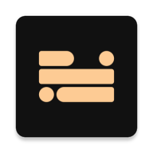

<div align="center">



# FOCUSPHONE

<strong>un launcher minimalista para android que sustituye tu pantalla de inicio por texto:<br>
un reloj, tus widgets y solo las apps que de verdad usas.</strong>

<sub><a href="../readme.md">english</a> · castellano</sub>

<br><br>

<a href="https://github.com/rezzt-dev/focusphone-app/releases"></a>

<a href="https://github.com/rezzt-dev/focusphone-app/actions/workflows/android-ci.yml"></a>

<br>


<a href="../license"></a>

<br><br>

<a href="../documentation/es/README.md"><b>documentación</b></a> ·
<a href="./changelog.md"><b>changelog</b></a> ·
<a href="./privacy.es.md"><b>privacidad</b></a> ·
<a href="../.github/security.es.md"><b>seguridad</b></a> ·
<a href="../.github/contributing.es.md"><b>contribuir</b></a> ·
<a href="https://focusphone.rezzt.dev"><b>web</b></a>

</div>

---

## ÍNDICE

- [visión general](#visión-general)
- [funcionalidades](#funcionalidades)
- [instalación](#instalación)
- [verificar el apk](#verificar-el-apk)
- [compilar desde el código](#compilar-desde-el-código)
- [estructura del repositorio](#estructura-del-repositorio)
- [arquitectura y tecnología](#arquitectura-y-tecnología)
- [documentación](#documentación)
- [privacidad y seguridad](#privacidad-y-seguridad)
- [estado del proyecto](#estado-del-proyecto)
- [contribuir](#contribuir)
- [licencia](#licencia)

---

## VISIÓN GENERAL

la mayoría de los launchers de android están pensados para que abras apps: iconos de
colores, globos rojos y cuadrículas llenas de sugerencias funcionan como recordatorios
constantes. **focusphone parte de la idea contraria: la pantalla de inicio debe ser un sitio
de paso, no un sitio donde quedarse.** las apps se muestran como texto, las favoritas tienen
un máximo de diez, y los bloqueos —una vez configurados tras una contraseña— están
diseñados para mantenerse.

sus bloqueos son **un compromiso contigo, no una herramienta de seguridad**: focusphone no
es administrador del dispositivo y no puede impedir que la desinstales ni que cambies de
launcher. consulta [`disclaimer.es.md`](./disclaimer.es.md).

### PRINCIPIOS DE DISEÑO

| principio | cómo se aplica en el código |
|---|---|
| **texto antes que iconos** | las favoritas son solo etiquetas; los iconos solo existen en el cajón de apps y en los selectores |
| **sin conexión por construcción** | la app no declara el permiso `INTERNET`: no hay capa de red que auditar |
| **bloqueos que aguantan** | las contraseñas de detox y de horarios se guardan con pbkdf2 y tienen límite de intentos (5, y después 15 minutos); una contraseña incorrecta nunca borra una regla |
| **un único camino para abrir apps** | toda apertura —inicio, cajón, accesos directos y widgets, incluso en otros launchers— pasa por `BaseActivity.openApp` / `openShortcut`, que aplican perfil, horario y pausa consciente |
| **una única fuente de color** | todo color en tiempo de ejecución pasa por `FocusPalette` / `FocusColors`, nunca por `resolveAttribute` |
| **la lógica pura se puede probar** | la evaluación de horarios, la matemática de la cuadrícula, la serialización de carpetas, el contraste y la búsqueda difusa viven en clases puras con pruebas unitarias |

---

## FUNCIONALIDADES

| área | qué ofrece |
|---|---|
| **pantalla de inicio** | una cuadrícula de 3-6 columnas por 4-12 filas con un reloj (digital, apilado, en palabras, analógico u oculto), hasta 10 apps favoritas como texto y los widgets que quieras; se edita en el sitio arrastrando, con asas de tamaño y acciones de accesibilidad |
| **widgets** | 20 widgets propios (relojes, calendario, música, búsqueda, favoritas, batería, almacenamiento, sistema, ajustes rápidos, próxima alarma, perfil de enfoque, intención, progreso) que siguen tu tema y funcionan en cualquier launcher, más un selector para los widgets de tus otras apps |
| **herramientas de enfoque** | perfiles (normal, trabajo, detox con temporizador y contraseña), horarios por app con franjas y límites diarios, y una pausa consciente: una respiración guiada antes de abrir una app |
| **cajón** | todas las apps con búsqueda difusa, carpetas de texto, nombres personalizados, accesos directos y desinstalación mediante el diálogo de android |
| **apariencia** | cuatro temas, día/noche automático, un tema personalizado con control de contraste, cuatro tipografías (sistema, poppins, comfortaa, jetbrains mono), tamaños de texto separados para la app y la home (8-24 pt), alineación y fondos de pantalla con desenfoque y control de legibilidad |
| **notificaciones** | un panel lateral opcional y un gesto hacia abajo para la persiana del sistema |
| **idiomas** | inglés, inglés británico, español, francés y alemán |

la guía de usuario completa está en [`documentation/es`](../documentation/es/README.md).

---

## INSTALACIÓN

focusphone se distribuye como apk desde la pestaña
[releases](https://github.com/rezzt-dev/focusphone-app/releases). **no está en google play**.

1. descarga `focusphone-*.apk` (y `SHA256SUMS`) de la última release.
2. abre el apk en el móvil y permite "instalar aplicaciones desconocidas" al navegador o
   gestor de archivos desde el que lo abres.
3. pulsa el botón de inicio y elige **focusphone** como app de inicio, o usa
   **ajustes → sistema → launcher predeterminado** dentro de la app.

requisitos: android 7.0 (api 24) o posterior; sin root, sin cuenta y sin conexión a internet.

> **¿vienes de `v1.0.0-beta`?** esa compilación se firmó con otra clave, así que android no
> la actualiza encima. desinstálala primero (se pierden sus ajustes, porque focusphone no
> guarda copias de seguridad) e instala después la última release.

---

## VERIFICAR EL APK

```bash
sha256sum -c SHA256SUMS
apksigner verify --print-certs focusphone-*.apk     # build-tools del sdk de android
```

| | |
|---|---|
| esquema de firma | apk signature scheme v2 |
| sha-256 del certificado de firma (desde `v1.4-beta`) | `0f:f1:f8:3c:32:e0:5d:c5:4b:c2:2b:a2:8a:13:df:4c:5c:37:ec:79:c4:1d:b3:e1:4a:d7:20:e7:c8:a0:76:2f` |

un apk firmado con cualquier otro certificado no es una compilación oficial. detalles en
[`security.es.md`](../.github/security.es.md#verificar-un-apk).

---

## COMPILAR DESDE EL CÓDIGO

| requisito | versión |
|---|---|
| android studio | una versión compatible con agp `9.3.0` |
| jdk | `21`, aprovisionado mediante la toolchain del daemon de gradle |
| android sdk | compile sdk `36` |

```bash
git clone https://github.com/rezzt-dev/focusphone-app.git
cd focusphone-app/focusphone-project
./gradlew :app:assembleDebug        # compila un apk de depuración
./gradlew :app:installDebug         # lo instala en un dispositivo conectado
```

abre `focusphone-project/` —**no** la raíz del repositorio— en android studio. el pipeline
de verificación, el mismo que ejecuta la ci en cada push y pull request:

```bash
./gradlew staticAnalysis --continue
./gradlew :app:testDebugUnitTest :app:lintDebug :app:assembleRelease
```

la firma de publicación es opcional y se configura con cuatro propiedades `RELEASE_*` fuera
del control de versiones; sin ellas `assembleRelease` genera un apk sin firmar. consulta
[`03-entorno-y-compilacion.md`](../documentation/es/desarrolladores/03-entorno-y-compilacion.md).

---

## ESTRUCTURA DEL REPOSITORIO

```txt
focusphone-app/
├── focusphone-project/          # el proyecto android (raíz de gradle, un único módulo :app)
├── documentation/               # documentación bilingüe de usuario y de desarrollo
│   ├── en/{users,developers}/
│   └── es/{usuarios,desarrolladores}/
├── .github/                     # ci, política de dependencias, plantillas de issues y pr, y
│                                # los ficheros de comunidad: security, contributing,
│                                # code_of_conduct, support (cada uno + .es.md)
├── repo-docs/                   # información del proyecto
│   ├── changelog.md             # changelog bilingüe, fuente de verdad de las releases
│   ├── readme.es.md             # este readme en castellano
│   ├── privacy.md · permissions.md · disclaimer.md   # (cada uno + .es.md)
│   └── third_party_licenses.md  # inventario y textos de las licencias de terceros
├── agents.md · claude.md        # guía de trabajo para agentes de ia y mantenedores
├── license · notice             # licencia no comercial y aviso de copyright
└── readme.md
```

---

## ARQUITECTURA Y TECNOLOGÍA

clean architecture (ligera) con mvvm, en un único módulo `:app`: `data` (room para las
favoritas, `SharedPreferences` para los ajustes, aes-256/gcm mediante el almacén de claves de
android para el contenido del usuario), `domain` (modelos, casos de uso y reglas puras como
`GridLayoutEngine` y `AppScheduleEvaluator`) y `ui` (views + view binding, sin compose). la
inyección de dependencias es manual, mediante `AppContainer`.

| área | elección |
|---|---|
| lenguaje | kotlin (biblioteca estándar `2.2.20`), corrutinas + `StateFlow` |
| ui | views de android, view binding, material components `1.14.0` |
| persistencia | room `2.8.5` · `SharedPreferences` · almacén de claves de android |
| compilación | gradle `9.7.1` · agp `9.3.0` · catálogo de versiones, actualizado solo a mano |
| calidad | android lint y detekt `1.23.8` sin línea base · ktlint `1.8.0` |
| pruebas | junit4 · mockk · robolectric · turbine · espresso |

detalles: [arquitectura](../documentation/es/desarrolladores/01-arquitectura.md) ·
[estructura del proyecto](../documentation/es/desarrolladores/02-estructura-del-proyecto.md) ·
[`agents.md`](../agents.md). componentes de terceros y sus licencias:
[`third_party_licenses.md`](./third_party_licenses.md).

---

## DOCUMENTACIÓN

| | castellano | english |
|---|---|---|
| índice | [documentation/es](../documentation/es/README.md) | [documentation/en](../documentation/en/README.md) |
| usuarios (12 capítulos) | [qué es focusphone](../documentation/es/usuarios/01-que-es-focusphone.md) | [what is focusphone](../documentation/en/users/01-what-is-focusphone.md) |
| desarrolladores (12 capítulos) | [arquitectura](../documentation/es/desarrolladores/01-arquitectura.md) | [architecture](../documentation/en/developers/01-architecture.md) |
| preguntas frecuentes | [preguntas frecuentes](../documentation/es/usuarios/12-preguntas-frecuentes.md) | [faq](../documentation/en/users/12-faq.md) |

<!-- TODO(owner): capturas de la cuadrícula de inicio, del modo edición y del selector de widgets; todavía no hay ninguna versionada. -->

---

## PRIVACIDAD Y SEGURIDAD

- sin permiso `INTERNET`, sin cuentas, sin analítica y sin informes de errores: nada sale del
  dispositivo. la política completa es [`privacy.es.md`](./privacy.es.md).
- tres permisos de instalación (`QUERY_ALL_PACKAGES`, `REQUEST_DELETE_PACKAGES`,
  `EXPAND_STATUS_BAR`) y dos servicios opcionales (accesibilidad y acceso a notificaciones),
  cada uno justificado en [`permissions.es.md`](./permissions.es.md).
- los datos sensibles se cifran con aes-256/gcm mediante el almacén de claves de android y se
  excluyen de las copias de seguridad y de la transferencia entre dispositivos.
- informa de vulnerabilidades en privado, nunca en un issue público:
  [`security.es.md`](../.github/security.es.md).

---

## ESTADO DEL PROYECTO

| elemento | valor |
|---|---|
| **versión actual** | `1.4.0-beta` (`versionCode` 4) — **beta** |
| **paquete** | `app.focusphone` |
| **distribución** | apk desde las [releases de github](https://github.com/rezzt-dev/focusphone-app/releases), marcadas como pre-release; no está en google play |
| **ramas** | `beta-1.X` (desarrollo) → `version-beta` (versiones estables) → `main` (publicada) |

beta significa que las funcionalidades están completas y probadas, pero la app se sigue
validando en más dispositivos y versiones de android. cada cambio está en
[`changelog.md`](./changelog.md).

---

## CONTRIBUIR

las contribuciones son bienvenidas. lee [`contributing.es.md`](../.github/contributing.es.md)
(entorno, ramas, formato de commits y de changelog, código sensible) y el
[código de conducta](../.github/code_of_conduct.es.md). para pedir ayuda, consulta
[`.github/support.es.md`](../.github/support.es.md).

---

## LICENCIA

focusphone se distribuye con una **licencia no comercial propia** ([`license`](../license)):
puedes verlo, ejecutarlo, modificarlo y compartirlo con fines personales, educativos, de
investigación o de evaluación no comercial; el uso comercial requiere permiso por escrito del
autor. **no es una licencia de código abierto aprobada por la osi**. el texto en castellano
es el vinculante.

los componentes de terceros conservan sus propias licencias ([`notice`](../notice),
[`third_party_licenses.md`](./third_party_licenses.md)). contacto: `contacto@rezzt.dev`.

---

<div align="center">

<sub>focusphone — desarrollado por <a href="https://rezzt.dev"><b>rezzt.dev</b></a> · <a href="https://github.com/rezzt-dev">@rezzt-dev</a></sub>

</div>
